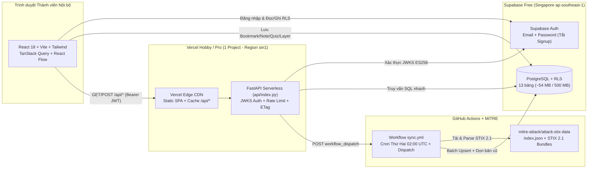

# 🛡️ ATT&CK Lab — Cyber Defense Studio

**ATT&CK Lab** là ứng dụng web nội bộ phục vụ **học tập và trực quan hoá MITRE ATT&CK® bằng tiếng Việt** cho đội ngũ an toàn thông tin (2–10 thành viên). Ứng dụng giữ nguyên các thuật ngữ chuẩn tiếng Anh của MITRE (*Tactic, Technique, Sub-technique, Detection Strategy, Analytic, Data Component, Mutable Element*) kèm giải thích tiếng Việt ngắn gọn, ví dụ đời thường và mô hình phòng thủ thực chiến.

> [!IMPORTANT]
> **Phạm vi An toàn & Điều khoản Sử dụng**
> 1. **100% Giáo dục Phòng thủ (Defensive Education Only):** Dự án tuyệt đối **không** chứa mã khai thác (exploit), payload chạy được hay hướng dẫn tấn công hệ thống.
> 2. **Lưu ý gói Vercel Hobby (Free):** Theo điều khoản dịch vụ của Vercel, gói **Hobby** chỉ dành cho mục đích **cá nhân, học tập, phi thương mại (personal, non-commercial use)**. Nếu triển khai ứng dụng này phục vụ hoạt động nội bộ doanh nghiệp/thương mại, vui lòng rà soát điều khoản và chuyển sang **Vercel Pro** (hoặc Cloudflare Pages kết hợp môi trường chạy API phù hợp).

---

## ✨ Tính năng Nổi bật

1. **Tổng quan (Dashboard Live):** Đọc trực tiếp phiên bản ATT&CK hiện hành từ cơ sở dữ liệu (không hard-code số lượng/ID/version), hiệu ứng đếm số liệu trực tiếp, thẻ *Tiếp tục học*, *Case nổi bật* và *Có gì mới*.
2. **Matrix Explorer (Enterprise / Mobile / ICS):**
   - Hỗ trợ đầy đủ **15 Tactics của Enterprise ATT&CK v20+** (bao gồm hai Tactic mới tách từ `Defense Evasion` cũ là **Stealth `TA0005`** và **Defense Impairment `TA0112`** kèm banner giải thích trực quan).
   - Lọc tức thì theo từ khoá (Fuse.js `< 5ms`), lọc theo Platform (kể cả nền tảng **`AI`** mới), chế độ **Heatmap độ phổ biến thực tế** & **Coverage của tôi**, huy hiệu `NEW`, sticky tactic header cuộn mượt 60fps.
   - **Technique Slide-over Panel:** Giải thích tiếng Việt của Lab tách biệt rõ với mô tả gốc tiếng Anh của MITRE; hiển thị cây trực quan **Detection Strategy (`DETxxxx`) → Analytic (`ANxxxx` + Log Sources + Mutable Elements) → Data Component (`DCxxxx`)**, Mitigations, Procedure Examples, Bookmark & Ghi chú Markdown cá nhân.
3. **Case Studies & Attack Chain Player (6 kịch bản):**
   - Đồ thị chuỗi tấn công tương tác bằng React Flow (*Play / Pause / Prev / Next*, timeline từng bước, MiniMap).
   - Công tắc **Góc nhìn Attacker ⇄ Defender** (đổi màu giao diện Đỏ/Xanh, lật giữa mô tả hành vi đời thường và Telemetry + Detection Strategy + Mitigation).
   - Tra cứu động 100% theo tên từ dữ liệu STIX 2.1 (gồm *SolarWinds Compromise*, *NotPetya*, *Operation Dream Job*, *2016 Ukraine Electric Power Attack (ICS)*, *APT32 / OceanLotus*, và *Kịch bản Minh hoạ Trợ lý AI Doanh nghiệp v20* được gắn nhãn giả định học tập rõ ràng).
   - Xuất ảnh **PNG** độ phân giải cao và tệp JSON chuẩn **ATT&CK Navigator v4.5**.
4. **Learning Path (8 bài học) + Thanh trượt `v18 → v19 → v20` + Mini Quiz:**
   - Lộ trình 8 bài từ cơ bản đến ứng dụng trong SOC/Threat Hunting, thanh từ điển thuật ngữ tương tác, widget **Pyramid of Pain** & chuỗi **DET → AN → DC**, thanh trượt tiến hoá **`v18 → v19 → v20`**, nút *"Thử ngay trên dữ liệu thật"* và Mini Quiz lưu điểm vào Supabase.
5. **Trang "Có gì mới" (Version Diff):** Đối chiếu tự động giữa hai phiên bản (ví dụ `19.2 → 20.1` hoặc `20.0 → 20.1`) theo từng domain (`Added`, `Modified`, `Deprecated`, `Revoked`).
6. **Coverage Lab & Explorer Phụ:**
   - Chấm điểm năng lực phát hiện của đội SOC (`0 / 50 / 100`), biểu đồ % bao phủ theo Tactic, gợi ý **Top kỹ thuật chưa bao phủ** xếp hạng theo mức độ phổ biến ngoài thực tế (`usage_count`), lưu/chia sẻ nội bộ và **Import/Export JSON chuẩn ATT&CK Navigator v4.5**.
   - Tra cứu **Groups / Software / Campaigns** và công cụ **So sánh giao thoa 2 Group (Biểu đồ Venn SVG + hệ số Jaccard)**.
7. **Trang Quản trị (`/admin` — chỉ `role = admin`) & Tìm kiếm toàn cục (`Ctrl/Cmd + K`):**
   - So sánh phiên bản DB với `index.json` trực tuyến của MITRE, nút **"Đồng bộ ngay"** kích hoạt GitHub Actions, giám sát dung lượng lưu trữ (`~54 MB / 500 MB`), quản lý danh sách `allowed_emails`, và công cụ **Kiểm tra sức khoẻ nội dung** (phát hiện bài học/case tham chiếu tới kỹ thuật bị `deprecated`/`revoked`).

---

## 🏗️ Kiến trúc Hệ thống



### Cấu trúc Thư mục Monorepo

```text
.
├── api/
│   └── index.py                     # Entrypoint mỏng cho Vercel Python Serverless Function
├── apps/
│   ├── api/                         # Backend FastAPI + STIX 2.1 Crawler/Parser
│   │   ├── app/                     # Auth JWKS, Middleware, DB Client & các Routers (/api/*)
│   │   ├── parser/                  # stix_loader.py, stix_mapper.py, diff_engine.py
│   │   ├── scripts/sync_attack.py   # CLI đồng bộ dữ liệu STIX 2.1 lên Supabase
│   │   └── tests/                   # Bộ kiểm thử Pytest (Auth/RLS, Parser, Content, Security)
│   └── web/                         # Frontend React 18 + TypeScript + Vite + Tailwind CSS
├── content/
│   ├── cases/                       # 6 kịch bản Case Study YAML (tra cứu động theo tên)
│   ├── lessons/                     # 8 bài học Markdown tiếng Việt
│   ├── quizzes/quizzes.yaml         # Câu hỏi Mini Quiz cuối mỗi bài học
│   └── glossary.yaml                # Từ điển thuật ngữ ATT&CK song ngữ Anh – Việt
├── supabase/
│   ├── migrations/0001_init_attack_lab.sql  # Toàn bộ Schema, Trigger Allowlist & RLS Policies
│   └── tests/verify_rls.sql         # Kịch bản SQL kiểm chứng cô lập dữ liệu RLS
├── .github/workflows/
│   ├── sync.yml                     # Đồng bộ tự động hằng tuần + bấm tay (workflow_dispatch)
│   └── ci.yml                       # Kiểm thử tự động Backend Pytest & Frontend Build
├── docker-compose.yml               # Chạy nhanh Backend API bằng Docker ở máy local
├── vercel.json                      # Cấu hình 1 Project thống nhất trên Vercel (sin1, noindex)
└── .env.example                     # Mẫu khai báo biến môi trường
```

---

## 🗄️ Bước 1: Khởi tạo Supabase Free (Region Singapore)

1. Đăng nhập [Supabase Dashboard](https://supabase.com/dashboard), tạo Project mới tại region **Southeast Asia (Singapore — `ap-southeast-1`)** và lưu lại mật khẩu Database ở nơi an toàn.
2. **Chạy Migration khởi tạo bảng & RLS:**
   - Mở **SQL Editor** trên Supabase Dashboard.
   - Mở tệp [`supabase/migrations/0001_init_attack_lab.sql`](./supabase/migrations/0001_init_attack_lab.sql), sao chép toàn bộ nội dung dán vào SQL Editor và bấm **Run**.
   - *(Tuỳ chọn)* Chạy tệp [`supabase/tests/verify_rls.sql`](./supabase/tests/verify_rls.sql) trong SQL Editor để tự kiểm chứng các chính sách RLS và Trigger chặn email lạ.
3. **Tắt Đăng ký công khai & Bật đăng nhập Email + Mật khẩu:**
   - Vào **Authentication → Providers → Email**: bật **Enable Email provider**, **TẮT** tuỳ chọn **Confirm email** (nếu admin tự tạo mật khẩu cho thành viên nội bộ) để không phụ thuộc hạn mức gửi mail SMTP mặc định của Supabase.
   - Vào **Authentication → Sign Up / Attack Protection** (hoặc **User Signups**): **TẮT "Allow new users to sign up"** để khoá hoàn toàn đăng ký tự do.
4. **Thêm Email vào Allowlist & Tạo Tài khoản Admin đầu tiên:**
   - Trong **SQL Editor**, thêm email quản trị viên và đồng nghiệp vào bảng `allowed_emails` **trước khi** tạo user:
     ```sql
     insert into public.allowed_emails (email, role, note)
     values
       ('admin@ten-nhom.local', 'admin', 'Quản trị viên ATT&CK Lab'),
       ('analyst1@ten-nhom.local', 'member', 'Thành viên SOC')
     on conflict (email) do update set role = excluded.role;
     ```
   - Vào **Authentication → Users → Add user → Create new user**, nhập đúng email vừa thêm kèm mật khẩu mạnh và tích **Auto Confirm User**. Trigger `trg_on_auth_user_created` sẽ tự động khởi tạo hồ sơ trong bảng `public.profiles` với đúng quyền `admin`/`member` (nếu tạo email chưa nằm trong `allowed_emails`, trigger `trg_enforce_allowed_email` sẽ chặn ngay lập tức).
5. **Lấy thông tin kết nối cho Backend & Frontend:**
   - **Project Settings → API / Data API**: lấy `Project URL` (`SUPABASE_URL`), `anon` / `publishable` key (`VITE_SUPABASE_ANON_KEY`), và `service_role` / `secret` key (`SUPABASE_SERVICE_ROLE_KEY` — **tuyệt đối chỉ đặt ở Backend/GitHub Secrets, không đưa lên Frontend**).
   - **Connect → Connection String → Transaction / Session Pooler (IPv4 compatible, port `5432`)**: sao chép chuỗi `DATABASE_URL` dạng:
     `postgresql://postgres.<project-ref>:<URL-ENCODED-PASSWORD>@aws-1-ap-southeast-1.pooler.supabase.com:5432/postgres`
     *(Lưu ý: nếu mật khẩu chứa ký tự đặc biệt như `@`, `#`, `%`, hãy mã hoá URL, ví dụ `@` → `%40`).*
   - **Xác thực JWT:** Backend FastAPI tự động tải khoá công khai từ endpoint JWKS (`/auth/v1/.well-known/jwks.json`, thuật toán bất đối xứng `ES256`/`RS256` trên Supabase hiện hành). Bạn **không** cần điền `SUPABASE_JWT_SECRET` trừ khi dùng project Supabase thế hệ cũ chỉ hỗ trợ `HS256`.

---

## 💻 Bước 2: Chạy ở Máy Cá nhân (Local Development)

### Yêu cầu cài đặt
- **Python 3.12+** và **Node.js 20+ (khuyến nghị Node 22)** *(hoặc Docker Desktop nếu muốn chạy API trong container)*.

### 1. Tạo tệp `.env.local` & Đồng bộ dữ liệu lần đầu
```bash
# 1) Tạo tệp cấu hình cục bộ (đã được .gitignore bảo vệ)
cp .env.example .env.local
# Điền VITE_SUPABASE_URL, VITE_SUPABASE_ANON_KEY, SUPABASE_URL, DATABASE_URL vào .env.local

# 2) Cài thư viện Python & Frontend
pip install -r apps/api/requirements-dev.txt
npm --prefix apps/web install

# 3) Đồng bộ dữ liệu MITRE ATT&CK STIX 2.1 (Enterprise, Mobile, ICS) lên Supabase
python -m apps.api.scripts.sync_attack --domain all --version latest
```
> Quá trình đồng bộ lần đầu mất khoảng 1–2 phút, tự động giữ bản STIX mới nhất cho cả 3 domain kèm snapshot SHA-256 của phiên bản liền trước để phục vụ trang **Có gì mới**. Tổng dung lượng cơ sở dữ liệu sau khi đồng bộ chỉ chiếm khoảng **`~54 MB`** (~10.7% hạn mức 500 MB của Supabase Free).

### 2. Khởi chạy Web & API bằng 2 lệnh
- **Cửa sổ Terminal 1 — Chạy Backend FastAPI (`http://127.0.0.1:8000`):**
  ```bash
  uvicorn apps.api.app.main:app --reload --port 8000
  ```
  *(Hoặc dùng Docker: `docker compose up`)*
- **Cửa sổ Terminal 2 — Chạy Frontend Vite (`http://localhost:5173`):**
  ```bash
  npm --prefix apps/web run dev
  ```
- Mở trình duyệt truy cập `http://localhost:5173` và đăng nhập bằng tài khoản nằm trong `allowed_emails`.

### 3. Chạy Bộ Kiểm thử Tự động
```bash
# Kiểm thử toàn bộ Backend (Auth JWKS, RLS, STIX Parser, Diff Engine, Content YAML/MD, Security Audit)
pytest -v

# Kiểm tra kiểu TypeScript & đóng gói Production Frontend
npm --prefix apps/web run build
```

---

## 🔄 Bước 3: Cấu hình GitHub Actions (Tự động Đồng bộ & Chống ngủ Supabase)

> [!TIP]
> **Giữ project Supabase Free luôn hoạt động:** Gói Supabase Free sẽ **tự động tạm dừng (auto-pause)** nếu không có truy vấn nào trong khoảng **7 ngày**. Workflow [`.github/workflows/sync.yml`](./.github/workflows/sync.yml) được lập lịch chạy tự động vào **02:00 UTC sáng Thứ Hai hằng tuần** — vừa tự động kiểm tra và cập nhật phiên bản MITRE ATT&CK mới nhất, vừa đóng vai trò "heartbeat" giữ cho project Supabase không bị tạm dừng.

1. Đẩy kho mã lên một repository GitHub (khuyến nghị để chế độ **Private** cho nhóm nội bộ).
2. Trên GitHub, mở **Settings → Secrets and variables → Actions → New repository secret** và tạo 3 khoá bí mật:
   | Tên Secret | Giá trị |
   | --- | --- |
   | `SUPABASE_URL` | `https://<project-ref>.supabase.co` |
   | `DATABASE_URL` | Chuỗi kết nối **Session Pooler IPv4 (port 5432)** của Supabase (đã URL-encode mật khẩu) |
   | `SUPABASE_SERVICE_ROLE_KEY` | Khoá `service_role` / `secret` của Supabase (dùng dự phòng khi không truyền `DATABASE_URL`) |
3. Chuyển sang tab **Actions → Sync MITRE ATT&CK STIX Data → Run workflow** (chọn `domain: all`, `version: latest`) để kiểm tra đồng bộ đám mây lần đầu và đối chiếu bảng lịch sử tại trang `/admin`.
4. **Tạo Fine-grained Token cho nút "Đồng bộ ngay" trên trang Admin:**
   - Vào **GitHub Settings → Developer settings → Personal access tokens → Fine-grained tokens → Generate new token**.
   - **Repository access:** chọn **Only select repositories** → chỉ chọn đúng repo `attack-lab` này.
   - **Repository permissions:** cấp duy nhất quyền **Actions: Read and write** (`Contents: Read-only` mặc định).
   - Lưu lại mã token này để điền vào biến `GITHUB_TOKEN_DISPATCH` trên Vercel ở Bước 4.

---

## 🚀 Bước 4: Triển khai lên Vercel Free (1 Project Thống nhất — Region `sin1`)

Dự án được thiết kế sẵn theo kiến trúc **1 Vercel Project duy nhất** thông qua tệp [`vercel.json`](./vercel.json): cả giao diện React SPA (`apps/web/dist`) và FastAPI Python Serverless Function (`api/index.py`) cùng chạy dưới một domain, đặt tại region **Singapore (`sin1`)** sát cạnh Supabase Singapore giúp giảm tối đa độ trễ và loại bỏ hoàn toàn rủi ro lỗi CORS trên môi trường Production.

1. Đăng nhập [Vercel Dashboard](https://vercel.com/dashboard) → bấm **Add New... → Project** → chọn repository GitHub của bạn.
2. Ở phần **Build and Output Settings**: giữ nguyên **Root Directory = `./`** (Vercel sẽ tự nhận diện `installCommand`, `buildCommand`, `outputDirectory` và `functions` từ [`vercel.json`](./vercel.json)).
3. Mở mục **Environment Variables** và khai báo các biến sau cho môi trường `Production` (và `Preview` nếu cần):

   | Biến Môi trường | Bắt buộc | Mô tả |
   | --- | :---: | --- |
   | `VITE_SUPABASE_URL` | Có | URL project Supabase (`https://<ref>.supabase.co`) |
   | `VITE_SUPABASE_ANON_KEY` | Có | Khoá công khai `anon` / `publishable` của Supabase |
   | `VITE_API_URL` | Để trống | Để rỗng `""` vì Frontend gọi trực tiếp `/api/*` cùng domain |
   | `SUPABASE_URL` | Có | URL project Supabase (cho FastAPI xác thực JWKS) |
   | `DATABASE_URL` | Có | Chuỗi kết nối **Session Pooler IPv4 (port 5432)** của Supabase |
   | `SUPABASE_SERVICE_ROLE_KEY` | Khuyến nghị | Khoá bí mật chỉ nằm trên máy chủ Serverless |
   | `GITHUB_REPO` | Có (cho Admin Sync) | Định dạng `ten-tai-khoan/ten-repo` |
   | `GITHUB_TOKEN_DISPATCH` | Có (cho Admin Sync) | Fine-grained PAT chỉ có quyền `Actions: Read & write` |
   | `GITHUB_WORKFLOW_FILE` | Tuỳ chọn | Mặc định `sync.yml` |
   | `GITHUB_WORKFLOW_REF` | Tuỳ chọn | Tên nhánh mặc định trên GitHub (ví dụ `main` hoặc `master`) |

4. Bấm **Deploy** và chờ khoảng 1 phút để Vercel hoàn tất build.
5. **Cập nhật URL trên Supabase Auth:**
   - Sao chép địa chỉ chính thức `https://<ten-du-an>.vercel.app`.
   - Quay lại **Supabase Dashboard → Authentication → URL Configuration**:
     - Đặt **Site URL** = `https://<ten-du-an>.vercel.app`.
     - Thêm `https://<ten-du-an>.vercel.app/**` và `http://localhost:5173/**` vào danh sách **Redirect URLs**.
6. **Kiểm tra Nghiệm thu từ thiết bị/mạng khác:**
   - Mở `https://<ten-du-an>.vercel.app` trên điện thoại hoặc máy tính khác mạng: người chưa đăng nhập tự động bị chuyển về `/login`; thử đăng nhập bằng tài khoản trong `allowed_emails`, mở `/matrix`, bấm vào 1 kỹ thuật xem cây Detection, mở `/cases` bấm **Play**, và bấm **Đồng bộ ngay** tại `/admin`.

*(Ghi chú: Nếu bạn muốn tách riêng thành 2 Vercel Project độc lập theo kiểu truyền thống, chỉ cần trỏ Project Web vào Root Directory `apps/web` với `VITE_API_URL=https://<api-domain>.vercel.app`, và đặt `ALLOWED_ORIGINS=https://<web-domain>.vercel.app` ở Project API).*

---

## 🔒 Thiết kế Bảo mật & Tối ưu Gói Miễn phí

- **Chặn truy cập trái phép nhiều lớp:** Tắt đăng ký tự do trên Supabase + Trigger DB `trg_enforce_allowed_email` + Row Level Security (`auth.uid() = user_id`) cho toàn bộ bảng cá nhân (`bookmarks`, `notes`, `progress`, `quiz_attempts`, `coverage_layers`) + Middleware xác thực chữ ký số **JWKS** trên mọi API đọc/ghi dữ liệu.
- **Chống lập chỉ mục công cụ tìm kiếm:** Cả thẻ `<meta name="robots">`, header tĩnh trong `vercel.json` và middleware FastAPI đều gắn `X-Robots-Tag: noindex, nofollow, noarchive`.
- **Tiết kiệm tối đa Invocation & Băng thông Vercel Hobby:**
  - Endpoint `/api/matrix/{domain}` đọc từ **1 dòng JSONB dựng sẵn duy nhất** (`attack_matrix_views`) kèm `ETag` (`304 Not Modified`) và `Cache-Control: public, max-age=3600, s-maxage=3600, stale-while-revalidate=86400` + `Vary: Authorization`.
  - Mọi tác vụ tải & phân tích STIX nặng (~60 MB JSON) được tách hoàn toàn sang **GitHub Actions**, giữ thời gian chạy của các API trên Vercel ở mức vài chục mili-giây và kích thước Python bundle gọn nhẹ (`excludeFiles` loại bỏ toàn bộ `apps/web`, `.cache`, `tests`).

---

## 📜 Bản quyền & Ghi công Dữ liệu

- **MITRE ATT&CK®** và **ATT&CK®** là nhãn hiệu đã đăng ký của **The MITRE Corporation**.
- Nguồn dữ liệu STIX 2.1 chính thức: [`mitre-attack/attack-stix-data`](https://github.com/mitre-attack/attack-stix-data) — `© The MITRE Corporation`, phát hành theo giấy phép [Apache License 2.0](https://github.com/mitre-attack/attack-stix-data/blob/master/LICENSE.txt).
- Các phần *"Giải thích bình dân của Lab"*, kịch bản diễn giải tiếng Việt và *Kịch bản Minh hoạ AI (v20)* là nội dung biên soạn phục vụ mục đích học tập nội bộ của **ATT&CK Lab**, không phải tài liệu chính thức của MITRE.
